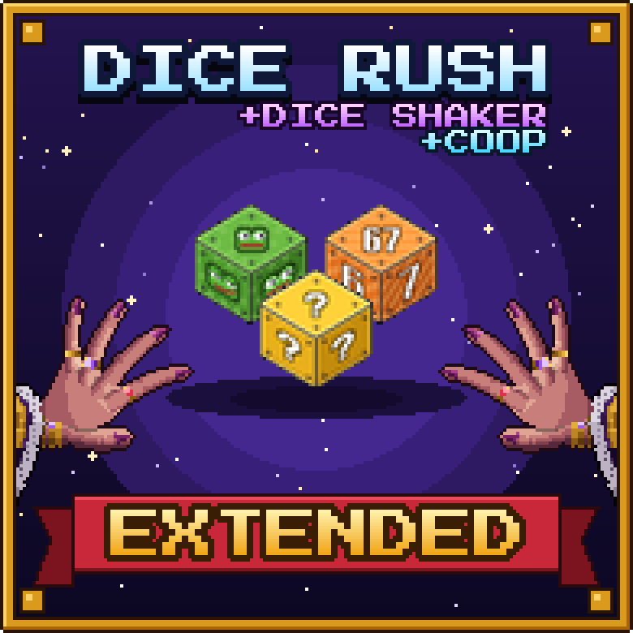
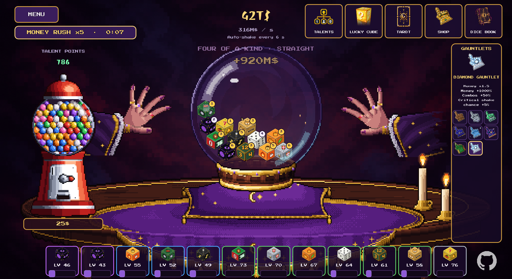

  

# Dice Rush Extended

**Dice Rush Extended** is a big fan mod for **DICE RUSH**. It adds 100 new dice with their own effects, a shop,
staff, new talents, tarot cards, lucky cube rewards, random events and achievements, keeps the game smooth
with thousands of dice on the table, and lets you play **coop with a friend**.

It also comes with **Dice Shaker**, a whole new game mode: shake a crystal ball full of dice on a fortune
teller's table.

## What the mod adds to the game

- **100 new dice in 10 tiers**: Pepe, 67, Twitch, YouTube, Pirate, Console, D&D, Lucky Block, Godot, Vault,
  Zombie, Racing Car, Tetris, Doge, Rickroll, Skibidi, Ohio, Gigachad, Black Hole, Supernova and many more.
  Every dice has its own effect: fire cones, lightning, trains and racing cars that roll everything in their
  way, rockets, auras, combos, jackpots, a dice that builds new dice ...
- **Shop button**: sell dice (choose how many), unlock new dice, and buy 10 mouse designs and 10 table
  designs (looks only, no advantage).
- **Hold to buy**: keep a buy button pressed and it buys faster and faster.
- **67 new talents**: dice unlocks, more workers, worker training for higher tiers, 13 dice families,
  selling, events, lucky cubes, tarot, staff, aura radius and chain power.
- **Lucky cubes**: levels for all new dice, 10 dice you can only get from lucky cubes, money bags, free dice,
  a lucky streak (x2 income) and talent gold.
- **40 new tarot cards** (minor arcana) with rarities. Only bought dice can be offered; better and more dice
  give better cards. Cards you already own are marked **OWNED**.
- **10 staff types**: mechanic, janitor, chef, banker, merchant, mage, scientist, DJ, miner and monk -
  each one has its own job on the table.
- **9 new random events**: meteor shower, coin rain, tornado, happy hour, rainbow, black cat, treasure
  chest, thief and lucky clover.
- **67 new achievements**.
- **Coop for 2 players** over the internet or LAN (IP address, Hamachi / Radmin VPN) or Steam invites.
  Both players see each other's mouse with its own design and a P1 / P2 tag.
- **500 more dice on the table**: up to **7,000 dice** fit on the table (the original game stops at 6,500).
- **Performance**: smooth even with thousands of dice (spatial grid, batched drawing, light-weight rolls,
  background warm-up). From 200 dice on, all dice get smaller and stay spread over the whole table.
- **Big numbers, written short**: 1, 10, 100, 1K, 1.1K, 1M, 1.1M, 1B, 1T, 1q, 1Q, 1s, 1S, 1o, 1N, 1d,
  then 1aa, 1ab ...
  never "e" notation.
- **Balanced progression**: the 10 tiers unlock one after another. A shop dice of tier 2 or higher needs
  dice of the tier below first, so the game keeps you busy for hours instead of minutes.
- **All 31 languages** of the game are supported.

## Dice Shaker - the new game mode

A calm, single-player game mode with its own save cards. Click **DICE SHAKER** in the main menu (under
NEW GAME) and pick one of its 3 save cards - they are separate from your normal saves.

- **The table**: a fortune teller's table with a purple tablecloth and cushion. On it sits a **crystal ball**
  on a wooden stand - the dice are inside the glass. The fortune teller's hands move closer to the ball and
  back, without ever touching it.
- **Shake**: click the ball (or hold the mouse button, or press SPACE). The dice fly around inside the glass,
  land and pay their faces. Equal faces make **combos**: pair, triple, four, five and six of a kind,
  straight and "all the same".
- **Dice level up**: you do not buy dice. You start with 1 die, and every die gains experience with every
  shake and levels up (up to level 100).
- **100 dice** from the original game and from this mod, sorted by **rarity** (common, uncommon, rare, epic,
  legendary), each with its own effect - critical hits, auras, combos, jackpots, echoes, money for every
  die in the ball, the digits of pi, a d20 ... Up to 6 big dice fit into the ball; the talent "Compact Dice"
  makes them smaller, then up to **12 dice** fit.
- **Gumball machine**: insert money, the crank turns and a gumball full of **talent points** rolls out.
  The colour shows how many points it holds (1 to 13), and every gumball costs more than the last.
- **Talent tree**: 52 talents, paid with talent points and money - more dice, faster and automatic shaking,
  money, combos, critical shakes, experience, cheaper Lucky Cube and tarot, and the black market contact.
- **Lucky Cube**: rerolls your dice into new ones - their **levels stay**. Lock the dice you want to keep.
  5 tiers from cheap (100 % common) to expensive (mostly epic and legendary); the chances are shown next to
  the ROLL button.
- **Tarot**: 30 new cards, drawn with money. Draw the same card again and it rises from common up to
  **legendary**.
- **Shop**: 30 **gauntlets** - mouse cursors with real bonuses (money, combos, experience, critical shakes,
  faster shaking ...). Every gauntlet you bought is listed on the right side of the screen with its effect:
  click one to equip it. 20 **table designs** (tablecloth and cushion, looks only).
- **Black market**: 30 illegal cards, only sold here - strong, stackable, with a limit per card.
- **Random events every 5 minutes**: 30 s shop and black market -50 %, talents -50 %, Lucky Cube -50 %,
  tarot -50 %, 10 s money rush (every shake pays x5) or 30 s turbo shake (auto-shake 1 s faster, the dice
  land faster).
- **Dice book**: all 100 dice; every die you discover gives +2 % money.
- No workers, no achievements, no coop and no story in this mode - just you, the ball and the dice.
  Its effects are calmer than in the normal game.

## Install

> [!WARNING]
> **Epilepsy / photosensitivity warning**
>
> This mod shows a lot of bright, colourful effects that flash quickly one after another – rolling dice, flashes, waves, rainbow and light effects, especially when the table is full.
> **If you have epilepsy or are sensitive to flashing lights, please do not download or play this mod.**
> If you feel dizzy or unwell while playing (for example blurred vision or twitching eyes or muscles), stop playing immediately and talk to a doctor.

1. Download **`Dice-Rush-Extended-1.2.0.zip`** from the [latest release](https://github.com/Minnteee/Dice-Rush-Extended/releases/latest).
2. Extract it into your DICE RUSH game folder, the folder that contains `Dice Rush.exe`
   (Steam: right click DICE RUSH -> Manage -> Browse local files).
   You should now have `override.cfg`, the folder `DiceRushExtended` and `Uninstall Dice Rush Extended.bat`
   next to `Dice Rush.exe`. Replace the files of an older version.
3. Start the game as usual. The main menu shows **"Dice Rush Extended 1.2.0"** at the bottom left and the
   new **DICE SHAKER** button under NEW GAME.

**Uninstall:** run `Uninstall Dice Rush Extended.bat` (or delete `override.cfg` and the `DiceRushExtended`
folder). Your saves are not deleted. The original game cannot store more than 9.2e18 money, so a modded
save with more money shows wrong amounts without the mod. The mod's achievements are stored in their own
file (`bdr_achievements.json`); the original achievements are not changed. Dice Shaker saves are the files
`shaker_slot_1.json` to `shaker_slot_3.json` in the game's save folder.

## Play

- Start a new game or continue your save - the new content is part of the normal game.
- The new dice appear in the shop list on the right. Locked dice are unlocked in the **Shop -> Unlock dice**
  tab, through the talent tree, lucky cubes or tarot cards. Every dice shows its effect in the tooltip.
- The **Shop** button (below the tarot button) also has the **Sell dice** and **Designs** tabs.
- Staff is hired in the shop list like workers. The new talents are in the talent tree (key `U`).
- Offer dice at the tarot shrine to get the new tarot cards.
- Random events show up by themselves - click coins, chests and clovers when they appear.
- For **Dice Shaker**, click **DICE SHAKER** in the main menu (see above).

## Host and Join

**Host (player 1)**
1. Click **HOST GAME** in the main menu (top right). Your last save is loaded and the game waits for player 2.
2. The coop button (next to the trophy at the top left) shows your IP addresses and can invite Steam friends.
3. Player 2 must be able to reach UDP port **47777** on your PC: same LAN, a VPN like Hamachi or Radmin VPN,
   or a forwarded port on your router.

**Join (player 2)**
1. Click **JOIN GAME** in the main menu.
2. Enter the host's IP address (port 47777) and click **CONNECT** - or join through Steam
   (friends list -> "Join Game", or accept the invite).

The game runs on the host's PC and uses the host's save. Player 2 plays on the same table with the same
money and can roll, buy, sell and use talents, lucky cubes and tarot. Both players need the same mod version.
Achievements are earned by the host. Dice Shaker is single player only.

## Game version

DICE RUSH **v1.0.0 (Full)** - Godot 4.7.1.

## Mod version

Dice Rush Extended **1.2.0** (with Dice Shaker) - final version. What changed in each version is written
in the [releases](https://github.com/Minnteee/Dice-Rush-Extended/releases).

## Players

1 player, or 2 players in coop. Dice Shaker: 1 player.

## Platform

Windows (PC), DICE RUSH v1.0.0 (Full).

## Source Code

The complete source code of the mod is in this repository, so you can learn from it and build your own mods:

| Folder | Contents |
| --- | --- |
| `src/bdr/` | the mod itself: core (grid, numbers, settings, translations), game systems (dice mechanics, shop, staff, talents, lucky cubes, tarot, events, achievements), coop networking, rendering and UI |
| `src/shaker/` | the Dice Shaker game mode: game data, rules, the crystal ball's dice physics, the scene, its screens (talents, Lucky Cube, tarot, shop, dice book), save cards and texts in 31 languages |
| `src/patches/` | changes to the original game scripts: function / variable blocks that replace or extend the original ones |
| `src/loader/` | `override.cfg` and `boot.gd`, which load the mod's `.pck` file at game start |
| `src/bdr/i18n/`, `tools/i18n/` | texts in all 31 languages |
| `tools/` | build tool, patch tool, dice catalog, art generators, test harness client |
| `tools/shaker/` | Dice Shaker: all game data and balance numbers (`shaker_design.py`), the balance simulation, sounds and text checks |
| `build/generated/bdr/art/`, `build/generated/shaker/` | all pixel art and sounds of the mod (made by the scripts in `tools/art/`, `tools/shaker_art/` and `tools/shaker/`) |

How to build the mod yourself is explained in [docs/BUILDING.md](docs/BUILDING.md).
The original game's files are **not** included - you need your own copy of DICE RUSH.

## License

You may improve this mod and use its code and art for your own mods **as long as you give credit**
("Dice Rush Extended by Minnteee", with a link to https://github.com/Minnteee).
See [LICENSE](LICENSE) for the full text.

This is the **final version**: the mod is provided as it is. There is no support, and bug reports, feature
requests and pull requests are not accepted - the repository is archived (read-only).

---

DICE RUSH is by Arlekino Games. This is a fan mod, not affiliated with Arlekino Games.

This mod was created only thanks to Claude Opus 5.5
