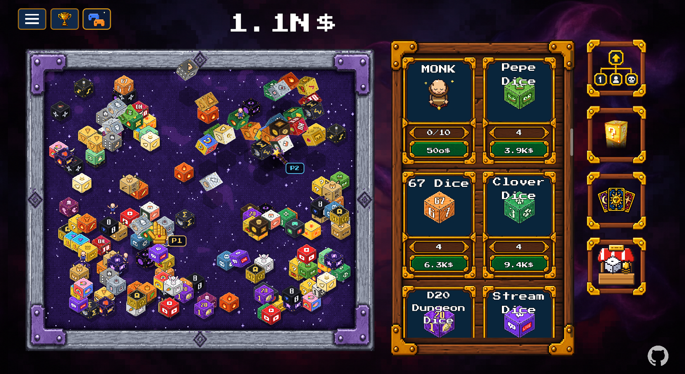

# Dice Rush Extended

**Dice Rush Extended** is a big fan mod for **DICE RUSH**. It adds 100 new dice with their own effects, a shop,
staff, new talents, tarot cards, lucky cube rewards, random events and achievements, keeps the game smooth
with thousands of dice on the table, and lets you play **coop with a friend**.

## What the mod adds

- **100 new dice in 10 tiers**: Pepe, 67, Twitch, YouTube, Pirate, Console, D&D, Lucky Block, Godot, Vault,
  Zombie, Racing Car, Tetris, Doge, Rickroll, Skibidi, Ohio, Gigachad, Black Hole, Supernova and many more.
  Every dice has its own effect: fire cones, lightning, trains and racing cars that roll everything in their
  way, rockets, auras, combos, jackpots, a dice that builds new dice ...
- **Shop button**: sell dice (choose how many), unlock new dice, and buy 10 mouse designs and 10 table
  designs (looks only, no advantage).
- **Hold to buy**: keep a buy button pressed and it buys faster and faster.
- **67 new talents**: dice unlocks, more workers, worker training for higher tiers, 13 dice families,
  selling, events, lucky cubes, tarot, staff, aura radius and chain power.
- **Lucky cubes**: levels for all new dice, 10 dice you can only get from lucky cubes, money bags, free dice,
  a lucky streak (x2 income) and talent gold.
- **40 new tarot cards** (minor arcana) with rarities. Only bought dice can be offered; better and more dice
  give better cards. Cards you already own are marked **OWNED**.
- **10 staff types**: mechanic, janitor, chef, banker, merchant, mage, scientist, DJ, miner and monk -
  each one has its own job on the table.
- **9 new random events**: meteor shower, coin rain, tornado, happy hour, rainbow, black cat, treasure
  chest, thief and lucky clover.
- **67 new achievements**.
- **Coop for 2 players** over the internet or LAN (IP address, Hamachi / Radmin VPN) or Steam invites.
  Both players see each other's mouse with its own design and a P1 / P2 tag.
- **500 more dice on the table**: up to **7,000 dice** fit on the table (the original game stops at 6,500).
- **Performance**: smooth even with thousands of dice (spatial grid, batched drawing, light-weight rolls,
  background warm-up). From 200 dice on, all dice get smaller and stay spread over the whole table.
- **Big numbers, written short**: 1, 10, 100, 1K, 1.1K, 1M, 1.1M, 1B, 1T, 1q, 1Q, 1s, 1S, 1o, 1N, 1d,
  then 1aa, 1ab ...
  never "e" notation.
- **Balanced progression**: the 10 tiers unlock one after another. A shop dice of tier 2 or higher needs
  dice of the tier below first, so the game keeps you busy for hours instead of minutes.
- **All 31 languages** of the game are supported.

## Changelog

**1.1.0**
- **500 more dice on the table**: the limit went up from 6,500 to 7,000 dice.
- Fixed: the tarot shrine loaded for a long time on a busy table and then went back to the table without
  letting you offer dice. It now opens at once - rolling dice finish instantly and pay out as usual.
- Fixed: on crowded tables the small dice gathered in the middle of the table. They now spread over the
  whole table again; saves from 1.0.0 are spread out once when they are loaded.
- The coop button now sits next to the achievements button (it was hidden behind it on wide screens).
- The GitHub logo is now also shown in the game, at the bottom right.
- Octillion is now written with a small "o" (a capital O looked like a zero in the game's font).

**1.0.0** - first release.

## Install

1. Download **`Dice-Rush-Extended-1.1.0.zip`** from the [latest release](https://github.com/Minnteee/Dice-Rush-Extended/releases/latest).
2. Extract it into your DICE RUSH game folder, the folder that contains `Dice Rush.exe`
   (Steam: right click DICE RUSH -> Manage -> Browse local files).
   You should now have `override.cfg`, the folder `DiceRushExtended` and `Uninstall Dice Rush Extended.bat`
   next to `Dice Rush.exe`.
3. Start the game as usual. The main menu shows **"Dice Rush Extended 1.1.0"** at the bottom left.

**Uninstall:** run `Uninstall Dice Rush Extended.bat` (or delete `override.cfg` and the `DiceRushExtended`
folder). Your saves are not deleted. The original game cannot store more than 9.2e18 money, so a modded
save with more money shows wrong amounts without the mod. The mod's achievements are stored in their own
file (`bdr_achievements.json`); the original achievements are not changed.

## Play

- Start a new game or continue your save - the new content is part of the normal game.
- The new dice appear in the shop list on the right. Locked dice are unlocked in the **Shop -> Unlock dice**
  tab, through the talent tree, lucky cubes or tarot cards. Every dice shows its effect in the tooltip.
- The **Shop** button (below the tarot button) also has the **Sell dice** and **Designs** tabs.
- Staff is hired in the shop list like workers. The new talents are in the talent tree (key `U`).
- Offer dice at the tarot shrine to get the new tarot cards.
- Random events show up by themselves - click coins, chests and clovers when they appear.

## Host and Join

**Host (player 1)**
1. Click **HOST GAME** in the main menu (top right). Your last save is loaded and the game waits for player 2.
2. The coop button (next to the trophy at the top left) shows your IP addresses and can invite Steam friends.
3. Player 2 must be able to reach UDP port **47777** on your PC: same LAN, a VPN like Hamachi or Radmin VPN,
   or a forwarded port on your router.

**Join (player 2)**
1. Click **JOIN GAME** in the main menu.
2. Enter the host's IP address (port 47777) and click **CONNECT** - or join through Steam
   (friends list -> "Join Game", or accept the invite).

The game runs on the host's PC and uses the host's save. Player 2 plays on the same table with the same
money and can roll, buy, sell and use talents, lucky cubes and tarot. Both players need the same mod version.
Achievements are earned by the host.

## Game version

DICE RUSH **v1.0.0 (Full)** - Godot 4.7.1.

## Mod version

Dice Rush Extended **1.1.0** - final version.

## Players

1 player, or 2 players in coop.

## Platform

Windows (PC), DICE RUSH v1.0.0 (Full).

## Source Code

The complete source code of the mod is in this repository, so you can learn from it and build your own mods:

| Folder | Contents |
| --- | --- |
| `src/bdr/` | the mod itself: core (grid, numbers, settings, translations), game systems (dice mechanics, shop, staff, talents, lucky cubes, tarot, events, achievements), coop networking, rendering and UI |
| `src/patches/` | changes to the original game scripts: function / variable blocks that replace or extend the original ones |
| `src/loader/` | `override.cfg` and `boot.gd`, which load the mod's `.pck` file at game start |
| `src/bdr/i18n/`, `tools/i18n/` | texts in all 31 languages |
| `tools/` | build tool, patch tool, dice catalog, art generators, test harness client |
| `build/generated/bdr/art/` | all pixel art of the mod (made by the scripts in `tools/art/`) |

How to build the mod yourself is explained in [docs/BUILDING.md](docs/BUILDING.md).
The original game's files are **not** included - you need your own copy of DICE RUSH.

## License

You may improve this mod and use its code and art for your own mods **as long as you give credit**
("Dice Rush Extended by Minnteee", with a link to https://github.com/Minnteee).
See [LICENSE](LICENSE) for the full text.

This is the **final version**: the mod is provided as it is. There is no support, and bug reports, feature
requests and pull requests are not accepted - the repository is archived (read-only).

---

DICE RUSH is by Arlekino Games. This is a fan mod, not affiliated with Arlekino Games.

This mod was created only thanks to Claude Opus 5.5
